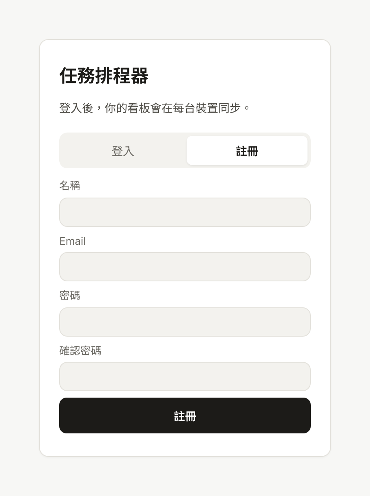
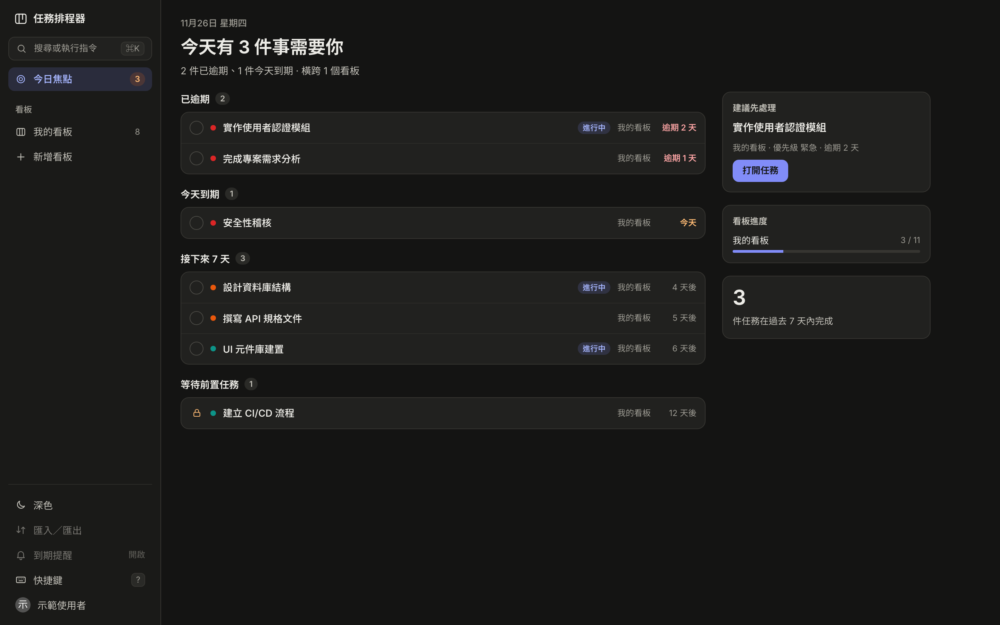
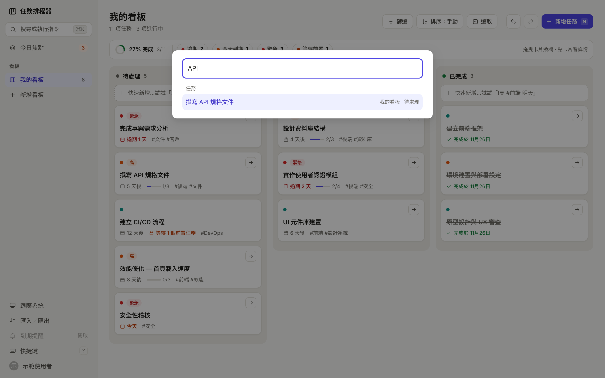

# 任務排程器 Task Scheduler

一個用看板管理待辦事項的網站。把工作分成「待處理／進行中／已完成」三欄，拖曳就能換狀態；「今日焦點」會把所有看板裡逾期、今天到期、快到期的事情排在一起，打開就知道今天該先做什麼。資料存在雲端，換電腦或用手機登入，看到的都是同一份。

**網站入口：<https://task-scheduler-rouge-gr925.vercel.app/>**


> 截圖說明：登入頁拍自正式網站；其餘畫面是同一版程式在本機用示範帳號與內建的範例任務拍攝（2026-11-26），不含任何真實使用者的資料。

## 開始使用



1. 打開上面的網站入口，會看到登入頁。
2. **第一次使用**：切到「註冊」分頁，填名稱、Email、密碼（8 到 128 個字元），再輸入一次密碼確認，按「註冊」。
3. 註冊完會直接登入並進到「今日焦點」。系統已經幫你建好一個「我的看板」。
4. 點左側的「我的看板」。看板是空的時候可以按「載入範例任務」先看看效果，或直接在任一欄頂端輸入任務標題、按 Enter 新增。
5. **之後再來**：在「登入」分頁輸入 Email 和密碼即可。要登出，點左下角你的名稱，選「登出」。

登入頁如果有出現「使用 GitHub 登入」或「使用 Google 登入」按鈕，也可以直接用那個帳號登入；沒有出現就表示目前網站沒有開放這種方式。

<br clear="right">

## 怎麼用

### 今日焦點

| 今日焦點（深色模式） | 手機版 |
|:---:|:---:|
|  |  |

把所有看板的任務分成「已逾期／今天到期／接下來 7 天／等待前置任務」四組，右側會建議你先處理哪一件，並顯示各看板的完成進度和過去 7 天完成了幾件。點每列前面的圓圈就能把那件事標記為完成。

### 看板與任務

- **新增看板**：左側「新增看板」，例如工作一個、私事一個。
- **新增任務**：每一欄頂端的「快速新增」輸入框，或右上角「新增任務」按鈕。
- **換狀態、排順序**：直接拖曳卡片。
- **看詳細內容**：點卡片，右側會打開詳細欄，可以改標題、描述、優先級、截止日、標籤、子任務和前置任務，改完立即儲存，不會擋住看板。
- **篩選**：看板上方的「逾期」「今天到期」「緊急」等統計標籤點一下就會篩選；另有「篩選」「排序」和搜尋。
- **一次處理多筆**：按「選取」勾選多張卡片，一起換狀態或刪除。
- **前置任務**：設定「A 要等 B 做完才能開始」。B 還沒完成時，A 會標示「等待前置任務」，不能被移到進行中。
- **刪錯了也沒關係**：刪除任務不會再問一次，畫面下方會出現約 6 秒的「復原」按鈕；任何修改都能用 `⌘Z`（Windows 用 `Ctrl+Z`）復原。只有刪除整個看板時會先確認。

### 快速新增的寫法

在「快速新增」框裡可以一次寫好優先級、標籤和截止日，輸入時會即時預覽解析結果。

| 寫法 | 效果 | 範例 |
|------|------|------|
| `!緊急` `!高` `!中` `!低`（或 `!0`–`!3`，全形 `！` 也可） | 優先級，沒寫就是「中」 | `!高` |
| `#標籤`（全形 `＃` 也可），可以寫好幾個 | 標籤 | `#前端 #bug` |
| `今天` `明天` `後天` | 截止日 | `明天` |
| `下週一` … `下週日` | 下週的那一天 | `下週五` |
| `月/日` | 今年的那天；已經過了就是明年 | `12/25` |
| 其他文字 | 任務標題 | |

例如輸入 `修 bug !高 #前端 明天`，會建立標題「修 bug」、優先級高、標籤「前端」、明天到期的任務。`!` 和 `#` 要放在開頭或空格後面才會被當成語法（所以 `C#` 仍是標題的一部分）。

### 指令面板（⌘K）



按 `⌘K`（Windows 用 `Ctrl+K`）或點左上角搜尋框，可以搜尋所有看板的任務並直接跳過去，也能執行常用動作：新增任務、前往今日焦點、切換看板或主題、匯出／匯入、開啟到期提醒、復原。找不到符合的任務時按 Enter，會用你輸入的文字新增一個任務。

### 其他功能

- **深色模式**：左下角可切換淺色／深色／跟隨系統。
- **手機**：側欄收進左上角選單、看板一次顯示一欄（用上方分頁切換）、任務詳細內容從下方滑出，右下角有新增按鈕。
- **到期提醒**：預設關閉，網站不會一打開就跟你要通知權限。在左下角或指令面板按「開啟到期提醒」並允許通知後，只要分頁開著，每 10 分鐘會檢查一次已逾期和 24 小時內到期的任務，同一件只提醒一次。
- **匯出／匯入**：左下角「匯入／匯出」可以把目前看板存成 JSON 檔備份。匯入時**只會取代目前這個看板**的任務，其他看板不受影響，匯入後也能用 `⌘Z` 復原。
- **舊版資料搬家**：如果你用過舊版（資料存在瀏覽器裡的那一版），登入後頁面上方會詢問要不要匯入。按「略過」也不會刪掉舊資料。

### 快捷鍵

在輸入框裡打字時，單一按鍵的快捷鍵不會觸發。按 `?` 隨時可以看這張表。

| 按鍵 | 功能 |
|------|------|
| `⌘K` / `Ctrl+K` | 開啟指令面板 |
| `N` | 新增任務 |
| `/` | 跳到搜尋 |
| `Esc` | 關閉詳細欄或視窗 |
| `1`–`9` | 切換到第幾個看板 |
| `G` 再按 `F` | 前往今日焦點 |
| `⌘Z` / `Ctrl+Z` | 復原 |
| `⌘⇧Z` / `Ctrl+Y` | 重做 |
| `?` | 快捷鍵說明 |

## 常見問題

**忘記密碼怎麼辦？**
目前沒有「忘記密碼」功能，請聯絡網站管理者協助。

**出現「嘗試太多次，請 N 秒後再試」？**
為了防止有人亂猜密碼，同一個網路位址（IP）每分鐘最多嘗試登入 5 次、註冊 3 次。等畫面上的秒數過了再試就好。

**出現「email 或密碼錯誤」？**
可能是 email 打錯，也可能是密碼錯。為了不讓別人藉此打聽誰有註冊，畫面不會告訴你是哪一個。注意密碼前後的空白也算在密碼裡。

**出現「這個 email 已經用另一種方式註冊過……」？**
代表這個 email 之前用另一種方式（例如 email＋密碼）註冊過，請改用當初的方式登入。如果你**從來沒有**用這個 email 註冊過，可能是別人搶先用了你的 email，請聯絡網站管理者處理。

**我的資料別人看得到嗎？**
看不到。每個帳號的看板和任務完全分開，只有你登入後才看得到自己的資料。

**換電腦或用手機也能看到嗎？**
可以。資料存在雲端，用同一個帳號登入就是同一份。

## 你的資料與安全

- **只有你看得到你的資料**：每一次讀寫都會先確認是你本人登入，別人的看板對你來說就像不存在。
- **密碼不會以明文保存**：密碼經過單向雜湊（scrypt）才存起來，連管理者也看不到你的密碼。網站不會用任何方式向你索取密碼，請不要把密碼告訴任何人。
- **防暴力破解**：登入與註冊都有嘗試次數限制（見上方常見問題）。
- **帳號不會被亂合併**：只有兩邊都確認過的同一個 email，才會把 GitHub 和 Google 登入視為同一人；用 email＋密碼註冊的帳號不會被自動合併。
- **發現安全問題？** 請私下聯絡作者，不要開公開的 issue。

---

## 給開發者

以下是架設和維護這個網站需要的資訊，一般使用者可以略過。

### 架構

前端與 API 在同一個 Next.js 專案裡，部署在 Vercel，資料存在 Neon Postgres。

```
app/            頁面（(auth)/login、(app)/ 今日焦點與看板）與 API（app/api/*）
src/server/     資料庫 schema、Better Auth 設定、各資源的 service（所有查詢都帶使用者 id）
src/client/     Redux store、RTK Query、復原／重做、快捷鍵
src/components/ 介面元件
src/lib/        前後端共用的純函式（快速新增解析、日期、排序位置、輸入檢查）
drizzle/        資料庫 migration
test/  e2e/     Vitest 單元與 API 測試、Playwright 端對端測試
```

技術棧：Next.js 16.4.6（App Router）、React 19.3.1、TypeScript 5.9.3、Ant Design 6.7.2、SCSS、Redux Toolkit 2.15.0（RTK Query）、@hello-pangea/dnd 18.0.1、Better Auth 1.7.27、zod 4.6.7、Drizzle ORM 0.45.4、Neon（`@neondatabase/serverless` 1.2.1）、Vitest 5.1.1 + PGlite、Playwright 1.65.1。

### 資安設計（技術細節）

- **密鑰不進版本庫。** 連線字串與 OAuth 密鑰只放在環境變數：本機在 `.env.local`（已被 `.gitignore` 排除），正式環境在 Vercel 專案設定。版本庫只有不含任何值的 `.env.example`。不要把真實的值寫進 README、issue、PR、commit 或截圖。
- **資料隔離。** 每個 API 都先確認登入（未登入回 401），所有資料庫查詢都以登入者的 id 篩選，別人的看板或任務 id 一律當作不存在（404）。
- **登入。** Better Auth：email／密碼在所有環境啟用（密碼 8–128 字元、以 scrypt 雜湊、不驗證 email）；GitHub／Google 只有 client id 與 secret 都設定時才啟用並顯示按鈕。帳號合併需要雙方 email 都已驗證，所以 email／密碼帳號不會和 GitHub／Google 自動合併。
- **嘗試次數限制。** 同一個 IP 每 60 秒最多登入 5 次、註冊 3 次，超過回 429 並帶 `X-Retry-After`。計數存在資料庫的 `rate_limit` 表，serverless 的多個實例共用。登入失敗不區分 email 不存在或密碼錯誤；註冊時會告知 email 已註冊（受上述次數限制）。
- **輸入檢查。** API 請求一律經過 zod 驗證並限制長度與數量；登入後的跳轉只接受站內路徑。email／密碼註冊與修改個人資料（含 Better Auth 內建的 `/api/auth/update-user`）時，名稱去頭尾空白後須為 1–60 字、email 最多 254 字元（僅 email／密碼註冊）、頭像只接受 `https://` 開頭且最多 2048 字元的網址（email／密碼註冊不收頭像）。GitHub／Google 建立的帳號名稱一樣截到 60 字，email 與頭像照 provider 提供的值儲存。
- **預覽部署受保護。** Vercel 的 Preview 網址開啟部署保護，只有專案成員能看；Preview 與 Production 使用不同的資料庫。

### 本機開發

需要 Node.js 20.9+ 與 npm。

1. 安裝相依套件：`npm install`
2. 準備資料庫：用 Vercel 上 Preview／Development 共用的那個非正式 Neon 資料庫（`vercel env pull .env.local` 會下載它的連線字串），或在 [Neon](https://neon.tech) 自己開一個。**不要用正式資料庫。**
3. （選填，不設定就只有 email／密碼登入）建立 GitHub OAuth App：Homepage URL `http://localhost:3000`、callback `http://localhost:3000/api/auth/callback/github`。
4. （選填）建立 Google OAuth 用戶端（類型「網頁應用程式」）：重新導向 URI `http://localhost:3000/api/auth/callback/google`。
5. 複製環境變數範本並填值：`cp .env.example .env.local`。用 `vercel env pull` 產生的 `.env.local` 裡，`DATABASE_URL` 是 Vercel 上 Development 環境的值；請確認它不是正式資料庫。
6. 建立資料表：`npm run db:migrate`。drizzle-kit 只讀 `.env`、不讀 `.env.local`，請先在 shell 設定 `DATABASE_URL`，例如 `export $(grep '^DATABASE_URL=' .env.local)`。
7. 啟動：`npm run dev`，開啟 `http://localhost:3000`。
8. 檢查：`npm test`、`npx tsc --noEmit`、`npm run lint`、`npm run build`。

### 環境變數

本機寫在 `.env.local`，正式環境在 Vercel 專案設定中設定同名變數。

| 變數 | 說明 |
|------|------|
| `DATABASE_URL` | Neon 的 Postgres 連線字串。驅動 `@neondatabase/serverless` 走 Neon 的 WebSocket，一般本機 Postgres 連不上；`npm test` 用 PGlite，不需要 |
| `BETTER_AUTH_SECRET` | 簽署登入 session 的密鑰，以 `openssl rand -base64 32` 產生；Production 與 Preview 各用一組，類型設為 Secret |
| `BETTER_AUTH_URL` | 網站的公開網址：本機 `http://localhost:3000`，正式環境 `https://task-scheduler-rouge-gr925.vercel.app` |
| `GITHUB_CLIENT_ID` / `GITHUB_CLIENT_SECRET` | 選填，兩個都有值才啟用 GitHub 登入 |
| `GOOGLE_CLIENT_ID` / `GOOGLE_CLIENT_SECRET` | 選填，兩個都有值才啟用 Google 登入 |

Vercel 的 Neon 整合還會加上 `POSTGRES_*`、`PG*`、`NEON_*` 等變數，本專案沒有用到，保留即可。

### npm scripts

| 指令 | 說明 |
|------|------|
| `npm run dev` | 開發伺服器 |
| `npm run build` | 正式建置 |
| `npm start` | 執行建置後的版本 |
| `npm run lint` | ESLint |
| `npm test` | 單元與 API 測試（Vitest + PGlite，不需要資料庫） |
| `npm run test:e2e` | 端對端測試（Playwright），見下節 |
| `npm run db:generate` | 依 schema 變更產生 migration |
| `npm run db:migrate` | 套用 migration（`DATABASE_URL` 需在 shell 設定） |
| `npm run db:studio` | Drizzle Studio |

### 端對端測試

`e2e/main-flow.spec.ts` 走完主要流程：快速新增 → 拖到進行中 → 詳細欄改優先級 → 刪除再復原 → 建第二個看板 → ⌘K 跳到另一個看板的任務 → 今日焦點 → 重新整理後資料仍在 → 全程沒有請求通知權限。`e2e/signup.spec.ts` 從登入頁的「註冊」分頁實際註冊，確認跳到 `/focus` 且側欄顯示新帳號名稱。

- 需要一個**測試專用的 Neon branch**，先套用 migration（`export DATABASE_URL=…` 後 `npm run db:migrate`），另需 `BETTER_AUTH_SECRET` 與 `BETTER_AUTH_URL=http://localhost:3000`。
- 首次執行先安裝瀏覽器：`npx playwright install chromium`。
- 沒有設定 `DATABASE_URL` 時整組測試會自動略過，`npm run test:e2e` 仍以 0 結束。每次執行都會在資料庫留下測試帳號，請只用在拋棄式的測試 branch。
- 註冊每個 IP 每分鐘限 3 次，一次執行會用掉 2 次；一分鐘內重跑可能遇到 429。

### 部署到 Vercel

1. 把專案匯入 Vercel。`vercel.json` 已指定 framework（Next.js）、輸出目錄 `.next`，以及 build 指令 `npm run db:migrate && npm run build`。
2. 接上 Neon，**正式與非正式各用一個資料庫**（Vercel CLI 需 47 版以上，可用 `npx vercel@latest`）：
   - 正式：`vercel integration add neon --billing-plan free_v3 --meta region=sin1 -e production`
   - Preview 與本機開發：`vercel integration add neon --name task-scheduler-preview --billing-plan free_v3 --meta region=sin1 --meta auth=false -e preview -e development`

   每次部署都會先對該環境的資料庫跑 migration。若 Preview 和 Production 共用資料庫，任何分支的預覽部署都會把未合併的 migration 套到正式資料庫，所以一定要分開。
3. 設定其餘環境變數（見上節）。密鑰用 `vercel env add <名稱> --environment <環境>` 在終端機輸入，不要寫進任何檔案。
4. （選填）要提供 GitHub／Google 登入時，把 OAuth 的 callback 設成正式網域：`https://task-scheduler-rouge-gr925.vercel.app/api/auth/callback/github`、`…/api/auth/callback/google`。Preview 網址每次部署都不同，所以 OAuth 登入只在正式網址可用。
5. 部署。migration 失敗會讓部署失敗，不會上線。
6. 部署後檢查執行期 log 沒有 `Rate limiting could not determine a client IP`。讀不到用戶端 IP 時，Better Auth 會讓所有人共用同一個計數，任何人每分鐘送 5 次登入就能把所有人鎖住；若出現這行，請在 Better Auth 設定的 `advanced.ipAddress.ipAddressHeaders` 指定 `x-vercel-forwarded-for` 等 Vercel 提供的標頭。

### 管理者：處理被搶註的 email

因為不驗證 email，別人可能先用某人的 email 註冊，讓本人之後用 GitHub／Google 登入時被拒絕。收到申訴時，先用自己的方式確認申訴者真的擁有該 email，再把搶註帳號的 email 改成作廢值（例如 `released+<帳號 id>@invalid`）並刪除它的所有 session，email 就空出來了。

## Contributing

歡迎提交 Pull Request。請勿在 PR、issue 或 commit 中附上任何連線字串、密鑰或 `.env.local` 的內容。

## License

This project is licensed under the MIT License - see the [LICENSE](LICENSE) file for details.

## Author

Created by Gorman (2025.03)
