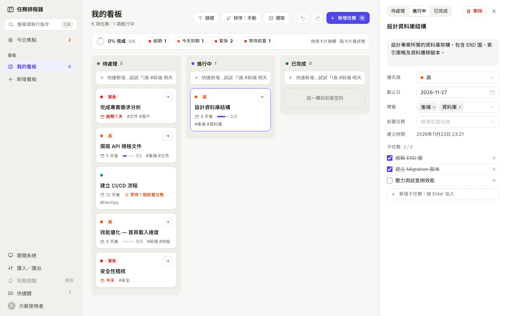
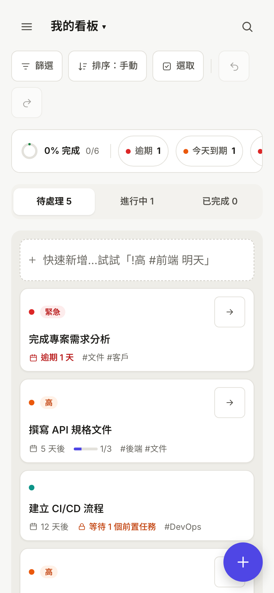

# 任務排程器 Task Scheduler

個人用的看板式任務管理。登入後資料存在雲端資料庫，每台裝置同步；「今日焦點」把所有看板裡該做的事排在一起，搭配快速新增語法與 ⌘K 指令面板，不離開鍵盤就能新增、跳轉、操作任務。

**網站入口：<https://task-scheduler-rouge-gr925.vercel.app/>**（用 email 註冊，或用 GitHub、Google 帳號登入；每個人的資料各自獨立）



| 今日焦點（深色模式） | 手機版 |
|:---:|:---:|
|  |  |

> 截圖是用示範帳號與內建的範例任務在本機拍攝，不含任何真實使用者資料。

## 功能

- **今日焦點**：跨看板彙整「已逾期 / 今天到期 / 接下來 7 天 / 等待前置任務」，並建議先處理哪一件，顯示各看板進度與過去 7 天完成數。
- **登入**：email／密碼註冊登入，或 GitHub、Google（後兩者只在有設定時提供）。沒有忘記密碼功能，忘記時請聯絡管理者；登入與註冊有嘗試次數限制（見「資安」）。
- **看板**：可建多個看板；待處理／進行中／已完成三欄，拖曳排序與換欄。統計列（完成率、逾期、今天到期、緊急、等待前置）的晶片同時是篩選器；另有篩選、排序與全文搜尋。
- **⌘K 指令面板**：搜尋所有看板的任務（標題與標籤）與動作（新增任務、前往今日焦點、切換看板與主題、匯出／匯入、開啟到期提醒、復原）；沒有結果時按 Enter 直接建立新任務。
- **智慧快速新增**：每欄頂端的輸入框即時解析語法並預覽（見下表）。
- **右側詳情欄**：直接編輯標題、描述、優先級、截止日、標籤、前置任務、子任務，不遮住看板。網址帶 `?task=<id>`，重新整理後會回到同一筆。
- **刪除即復原**：刪除不跳確認框，底部提示列約 6 秒內可按「復原」；所有變更都能 `⌘Z` 復原、`⌘⇧Z` 重做。刪除看板仍會先確認。
- **批次操作**：選取多筆任務後一次移動狀態或刪除；被前置任務擋住的任務會被略過並回報。
- **前置任務**：還有未完成前置任務的待處理任務會標示「等待前置任務」，在前置任務完成前不能開始；循環相依會被拒絕。
- **匯入／匯出**：匯出目前看板為 JSON；匯入**只會取代目前看板**的任務，其他看板不受影響，也能用 `⌘Z` 復原。可匯入舊版（Vite 版）匯出的檔案。
- **舊資料搬家**：第一次登入時，若這台瀏覽器還留有舊版存在 localStorage 的資料，頁面頂端會提示「匯入 / 略過」；舊資料本身不會被刪除。
- **到期提醒（需手動開啟）**：預設關閉，也不會一開頁就詢問權限。在側欄或指令面板按「開啟到期提醒」後，分頁開著時每 10 分鐘檢查一次逾期與 24 小時內到期的任務，同一筆只通知一次。
- **深色模式**：淺色／深色／跟隨系統。
- **手機版**（< 768px）：側欄變抽屜、看板一次顯示一欄、詳情欄改為底部面板、右下角浮動新增按鈕。

### 快速新增語法

| 寫法 | 效果 | 範例 |
|------|------|------|
| `!緊急` `!高` `!中` `!低`，或 `!0`–`!3`（全形 `！` 也可） | 優先級（0 緊急、1 高、2 中、3 低；預設中） | `!高` |
| `#標籤`（全形 `＃` 也可），可多個 | 標籤 | `#前端 #bug` |
| `今天` `明天` `後天` | 截止日 | `明天` |
| `下週一` … `下週日` | 下一個週一開始的那週的該天 | `下週五` |
| `M/D` | 截止日（今年；已過去則明年；不存在的日期如 `2/30` 視為標題文字） | `12/25` |
| 其餘文字 | 標題（去除頭尾與重複空白） | |

例如 `修 bug !高 #前端 明天` 會建立標題「修 bug」、優先級「高」、標籤「前端」、明天到期的任務。`!` 與 `#` 必須在字首或空白之後（`C#` 仍是標題）。「今天」以你的瀏覽器時區計算。

### 快捷鍵

單鍵快捷鍵在輸入框中不會觸發。按 `?` 可隨時開啟說明。

| 按鍵 | 功能 |
|------|------|
| `⌘K` / `Ctrl+K` | 開啟指令面板 |
| `N` | 新增任務 |
| `/` | 聚焦搜尋 |
| `Esc` | 關閉詳情欄或面板 |
| `1`–`9` | 切換到第 N 個看板 |
| `G` 然後 `F` | 前往今日焦點 |
| `⌘Z` | 復原 |
| `⌘⇧Z` / `Ctrl+Y` | 重做 |
| `?` | 快捷鍵說明 |

## 架構

前端與 API 在同一個 Next.js 專案裡，部署在 Vercel，資料存在 Neon Postgres。

```
app/            頁面（(auth)/login、(app)/ 今日焦點與看板）與 API（app/api/*）
src/server/     資料庫 schema、Better Auth 設定、各資源的 service（所有查詢都帶使用者 id）
src/client/     Redux store、RTK Query、復原／重做、快捷鍵
src/components/ 介面元件
src/lib/        前後端共用的純函式（快速新增解析、日期、排序位置、輸入檢查）
drizzle/        資料庫 migration
test/  e2e/     Vitest 單元與 API 測試、Playwright 端對端測試
```

## 資安

- **密鑰不進版本庫。** 所有連線字串與 OAuth 密鑰只放在環境變數：本機在 `.env.local`（`.env*.local` 已被 `.gitignore` 排除），正式環境在 Vercel 專案設定。版本庫裡只有不含任何值的 `.env.example`。不要把真實的值寫進 README、issue、PR 或截圖。
- **每個人只看得到自己的資料。** 每個 API 都先確認登入（未登入回 401），所有資料庫查詢都以登入者的 id 篩選；別人的看板或任務 id 一律當作不存在。
- **帳號合併要已驗證的 email。** GitHub 與 Google 回報相同 email、且雙方都標示已驗證時才視為同一人，避免用未驗證的 email 接管別人的帳號（見下方「登入與帳號連結」）。
- **密碼以 scrypt 雜湊儲存，登入有嘗試次數限制。** 伺服器在所有環境都接受 email／密碼註冊與登入（密碼 8–128 字元、不驗證 email，因此不會和 GitHub／Google 帳號自動合併）；同一個 IP 每 60 秒最多登入 5 次、註冊 3 次，超過回 429，計數存在資料庫的 `rate_limit` 表（不是記憶體，serverless 多個實例也共用）。登入失敗不區分 email 不存在或密碼錯誤；註冊時會告知 email 已註冊（每 IP 每分鐘 3 次）。登入頁送出前會先檢查名稱（1–60 字）、密碼長度與兩次密碼是否相同。
- **輸入一律檢查。** API 的請求內容都經過 zod 驗證並限制長度與數量；登入後的跳轉只接受站內路徑，避免被利用成開放式重新導向。email／密碼註冊與修改個人資料（包括 Better Auth 內建的 `/api/auth/update-user`）時，伺服器端也限制使用者資料：名稱去頭尾空白後 1–60 字、email 最多 254 字元（僅 email／密碼註冊）、頭像只接受 `https://` 開頭且最多 2048 字元的網址（email／密碼註冊不收頭像）。GitHub／Google 建立的帳號名稱一樣去空白並截到 60 字，但 email 不限長度、頭像照 provider 提供的值儲存。
- **預覽部署受保護。** Vercel 的 Preview 網址開啟了部署保護，只有專案成員能看。

如果發現安全問題，請私下聯絡作者，不要開公開 issue。

## 本機開發

需要 Node.js 20.9+ 與 npm。

1. 安裝相依套件：`npm install`
2. 準備資料庫：用 Vercel 上 Preview／Development 共用的那個非正式 Neon 資料庫（見「部署到 Vercel」第 2 步，`vercel env pull .env.local` 會下載它的連線字串），或在 [Neon](https://neon.tech) 自己開一個。**不要用正式資料庫。**
3. （選填，不設定就只有 email／密碼登入）建立 GitHub OAuth App（GitHub → Settings → Developer settings → OAuth Apps）：
   - Homepage URL：`http://localhost:3000`
   - Authorization callback URL：`http://localhost:3000/api/auth/callback/github`
4. （選填）建立 Google OAuth 用戶端（Google Cloud Console → API 和服務 → 憑證 → OAuth 用戶端 ID，類型「網頁應用程式」）：
   - 已授權的重新導向 URI：`http://localhost:3000/api/auth/callback/google`
5. 複製環境變數範本並填值：`cp .env.example .env.local`（各變數見下節）。
   > 用 `vercel env pull` 或 `vercel integration add neon` 產生的 `.env.local`，裡面的 `DATABASE_URL` 是 Vercel 上 Development 環境的值；若那個值指向正式資料庫，本機開發就會直接讀寫正式資料，請改成第 2 步的開發 branch。
6. 建立資料表：`npm run db:migrate`。drizzle-kit 只讀 `.env`、不讀 `.env.local`，請先在 shell 設定 `DATABASE_URL`，例如 `export $(grep '^DATABASE_URL=' .env.local)`。
7. 啟動：`npm run dev`，開啟 `http://localhost:3000`。未登入會被導向 `/login`；第一次登入會自動建立「我的看板」，空看板上可按「載入範例任務」。
8. 檢查：`npm test`、`npx tsc --noEmit`、`npm run lint`、`npm run build`。

## 環境變數

本機寫在 `.env.local`，正式環境在 Vercel 專案設定中設定同名變數。

| 變數 | 說明 |
|------|------|
| `DATABASE_URL` | Neon 的 Postgres 連線字串。資料庫驅動 `@neondatabase/serverless` 走 Neon 的 WebSocket，一般本機 Postgres 連不上；`npm test` 用 PGlite，不需要 |
| `BETTER_AUTH_SECRET` | 簽署登入 session 的密鑰，以 `openssl rand -base64 32` 產生；Production 與 Preview 各用一組 |
| `BETTER_AUTH_URL` | 網站的公開網址：本機 `http://localhost:3000`，正式環境 `https://task-scheduler-rouge-gr925.vercel.app` |
| `GITHUB_CLIENT_ID` / `GITHUB_CLIENT_SECRET` | GitHub OAuth App；選填，兩個都有值才啟用 GitHub 登入 |
| `GOOGLE_CLIENT_ID` / `GOOGLE_CLIENT_SECRET` | Google OAuth 用戶端；選填，兩個都有值才啟用 Google 登入 |

Vercel 的 Neon 整合還會加上 `POSTGRES_*`、`PG*`、`NEON_*` 等變數，本專案沒有用到，保留即可。

## npm scripts

| 指令 | 說明 |
|------|------|
| `npm run dev` | 開發伺服器 |
| `npm run build` | 正式建置 |
| `npm start` | 執行建置後的版本 |
| `npm run lint` | ESLint |
| `npm test` | 單元與 API 測試（Vitest + PGlite，不需要資料庫） |
| `npm run test:e2e` | 端對端測試（Playwright），見下節 |
| `npm run db:generate` | 依 schema 變更產生 migration |
| `npm run db:migrate` | 套用 migration（`DATABASE_URL` 需在 shell 設定） |
| `npm run db:studio` | Drizzle Studio |

## 端對端測試

`e2e/main-flow.spec.ts` 走完主要流程（以 `e2e/global-setup.ts` 註冊的測試帳號登入）：登入 → 快速新增 → 拖到進行中 → 詳情欄改優先級 → 刪除再復原 → 建第二個看板 → ⌘K 跳到另一個看板的任務 → 今日焦點 → 重新整理後資料仍在 → 全程沒有請求通知權限。`e2e/signup.spec.ts` 則不帶登入狀態，從登入頁的「註冊」分頁實際註冊，確認跳到 `/focus` 且側欄顯示新帳號名稱。

- 需要一個**測試專用的 Neon branch**（不能用一般本機 Postgres，原因見「環境變數」）。先套用 migration：`export DATABASE_URL=postgresql://…` 後執行 `npm run db:migrate`。
- 還要有 `BETTER_AUTH_SECRET` 與 `BETTER_AUTH_URL=http://localhost:3000`（GitHub／Google 變數可留空）。Playwright 會自行啟動 `npm run dev`，由 `e2e/global-setup.ts` 註冊一個測試帳號、把登入狀態存到 `e2e/.auth/`（已加入 `.gitignore`）。
- 首次執行先安裝瀏覽器：`npx playwright install chromium`。
- **沒有設定 `DATABASE_URL` 時整組測試會自動略過**，`npm run test:e2e` 仍以 0 結束。每次執行都會在資料庫留下測試帳號，請只用在拋棄式的測試 branch。

## 部署到 Vercel

1. 把專案匯入 Vercel。`vercel.json` 已指定 framework（Next.js）與輸出目錄 `.next`，會蓋過專案設定裡從舊 Vite 版留下的 `dist`。
2. 接上 Neon，**正式與非正式各用一個資料庫**（Vercel CLI 需 47 版以上，舊版可用 `npx vercel@latest`；條款在終端機裡確認）：
   - 正式：`vercel integration add neon --billing-plan free_v3 --meta region=sin1 -e production`
   - Preview 與本機開發：`vercel integration add neon --name task-scheduler-preview --billing-plan free_v3 --meta region=sin1 --meta auth=false -e preview -e development`

   兩者都會自動寫入各自環境的 `DATABASE_URL`，第二個指令也會把 Development 的值下載成本機 `.env.local`。
3. **為什麼要分開。** build 指令每次部署都會先跑 `db:migrate`，Preview 若和 Production 共用 `DATABASE_URL`，任何分支的預覽部署都會把尚未合併的 migration 套到正式資料庫，未審查的分支程式碼也能讀寫真實使用者資料。若已經把一個資料庫接到所有環境，用 `vercel integration resource disconnect <資源> <專案>` 再 `vercel integration resource connect <資源> <專案> -e production` 改成只接 Production。
4. 設定其餘環境變數（見上節；GitHub／Google 為選填）。密鑰用 `vercel env add <名稱> <環境>` 在終端機貼上，不要寫進任何檔案；`BETTER_AUTH_SECRET` 可直接 `openssl rand -base64 32 | vercel env add BETTER_AUTH_SECRET production`。
5. （選填，要提供 GitHub／Google 登入才需要）把 OAuth 的 callback 設成正式網域（或另外建一組給正式環境）：
   - GitHub：`https://task-scheduler-rouge-gr925.vercel.app/api/auth/callback/github`
   - Google：`https://task-scheduler-rouge-gr925.vercel.app/api/auth/callback/google`
6. 部署。`vercel.json` 的 build 指令是 `npm run db:migrate && npm run build`：先對該環境的資料庫套用尚未執行的 migration，成功才繼續建置；migration 失敗會讓部署失敗，不會上線。
7. 部署後檢查執行期 log 沒有 `Rate limiting could not determine a client IP`。Better Auth 預設讀 `x-forwarded-for`（Vercel 會用真實的用戶端 IP 覆寫這個標頭）；讀不到 IP 時它**不會略過限制，而是讓所有人共用同一個計數**（每個路徑一個），任何人每分鐘送 5 次登入就能把所有人的登入鎖住。若出現這行 log，請在 Better Auth 設定的 `advanced.ipAddress.ipAddressHeaders` 指定 `x-vercel-forwarded-for` 等 Vercel 提供的標頭。

Preview 網址每次部署都不同，GitHub／Google 只接受登記過的 callback，所以 OAuth 登入只在正式網址可用。舊版的訪客上線後必須登入；他們瀏覽器裡的舊資料會在登入後被偵測並提示匯入。

## 登入與帳號連結

登入頁一律有 email／密碼的「登入／註冊」分頁；GitHub 與 Google 按鈕只在該 provider 的 client id 與 secret 都有設定時顯示（都沒設定時連「或」分隔線都不出現）。email／密碼帳號的 email 未驗證，所以不會和 GitHub／Google 自動合併。GitHub 與 Google 兩邊回報**相同的 email、且都標示為已驗證**時，視為同一個帳號（同一份看板）；否則不會自動合併，這次登入會被拒絕並帶回登入頁，顯示「這個 email 已經用另一種方式註冊過，且尚未驗證，因此無法自動合併。請改用當初的方式登入。如果你沒有用這個 email 註冊過，請聯絡管理者。」。email 在使用者表中唯一，所以不會另建第二個帳號。

因為不驗證 email，別人可能先用你的 email 註冊密碼帳號，讓你之後用 GitHub／Google 登入時被拒絕。遇到這種情況請聯絡管理者：管理者人工確認 email 的擁有者後，把搶先註冊那個帳號的 email 改成作廢值（例如 `released+<帳號 id>@invalid`）並刪除它的所有 session，email 就空出來了。

## 技術棧

- **框架**：Next.js 16.4.6（App Router）、React 19.3.1、TypeScript 5.9.3
- **UI**：Ant Design 6.7.2（`@ant-design/nextjs-registry`）、SCSS（Sass 1.108.2）、Inter 與 Noto Sans TC
- **狀態與資料**：Redux Toolkit 2.15.0（RTK Query：全量載入、樂觀更新、復原／重做堆疊）
- **拖曳**：@hello-pangea/dnd 18.0.1
- **驗證與輸入檢查**：Better Auth 1.7.27（email／密碼，GitHub／Google OAuth 選填）、zod 4.6.7
- **資料庫**：Postgres（Neon，`@neondatabase/serverless` 1.2.1）、Drizzle ORM 0.45.4 與 drizzle-kit
- **測試**：Vitest 5.1.1（PGlite 作測試資料庫）、Testing Library、Playwright 1.65.1
- **部署**：Vercel

## Contributing

歡迎提交 Pull Request。請勿在 PR、issue 或 commit 中附上任何連線字串、密鑰或 `.env.local` 的內容。

## License

This project is licensed under the MIT License - see the [LICENSE](LICENSE) file for details.

## Author

Created by Gorman (2025.03)
