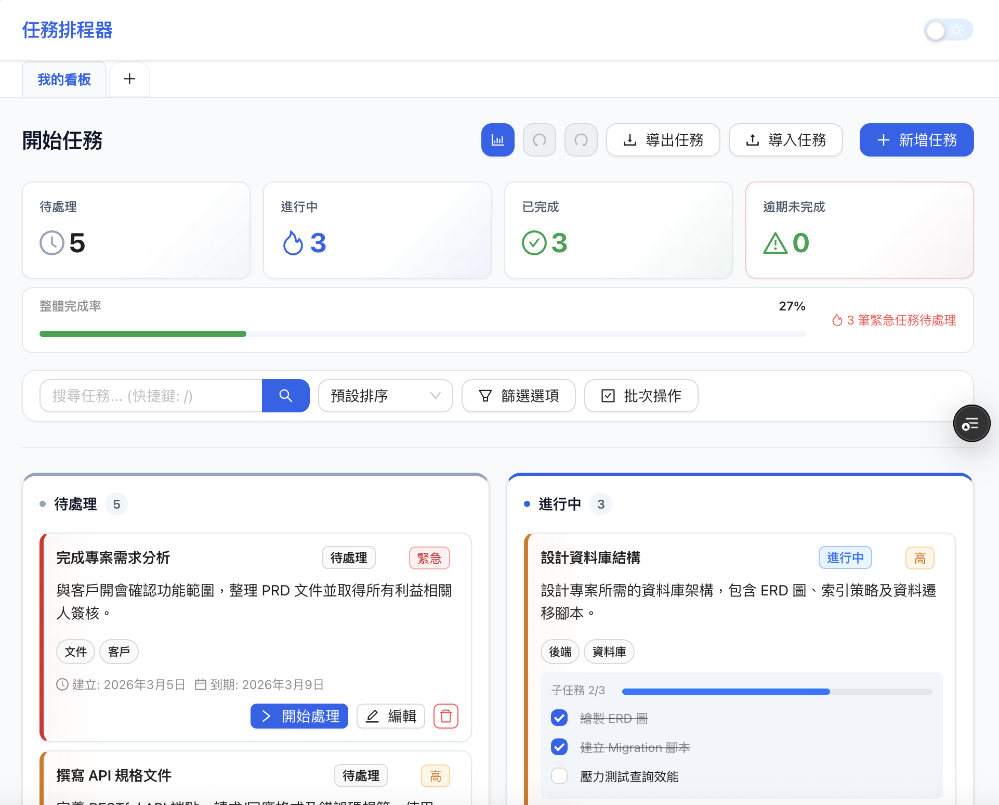

# Task Scheduler

A modern Kanban-style task management app built with React and TypeScript. Supports multi-board management, subtasks, task dependencies, browser notifications, drag-and-drop reordering, undo/redo history, and a fully responsive light/dark UI.

[DEMO](https://task-scheduler-rouge-gr925.vercel.app/)

## Features

**Task Management**
- Create, edit, and delete tasks with title, description, priority, due date, and tags
- Subtasks with individual checkboxes and a progress bar
- Task dependencies — block a task until its prerequisites are completed
- Batch operations: multi-select tasks to move or delete in bulk
- Undo / Redo support for all task mutations

**Boards**
- Multiple boards — create, rename, and delete boards independently
- Each board maintains its own task list and state

**Views & Filtering**
- Kanban columns: To-Do / In Progress / Done
- Drag and drop within and between columns
- Sort by priority or due date
- Filter by priority, deadline (Overdue / Today / This Week / Future), and tags
- Full-text search across task titles and descriptions

**Notifications & UX**
- Browser push notifications for overdue tasks and tasks due within 24 hours
- Statistics panel with completion rate and urgent task count
- Keyboard shortcuts: `N` new task, `/` focus search, `Ctrl+Z` undo, `Ctrl+Y` redo
- Quick-add input at the bottom of each column
- Light / Dark theme toggle

**Data**
- All data persisted in localStorage
- JSON export and import

## 本機開發

需要 Node.js 20.9+ 與 npm。

1. 安裝相依套件：`npm install`
2. 建立資料庫：在 [Neon](https://neon.tech) 建一個 Postgres 專案，複製連線字串（`postgresql://…`）。
3. 建立 GitHub OAuth App（GitHub → Settings → Developer settings → OAuth Apps）：
   - Homepage URL：`http://localhost:3000`
   - Authorization callback URL：`http://localhost:3000/api/auth/callback/github`
4. 建立 Google OAuth 用戶端（Google Cloud Console → API 和服務 → 憑證 → OAuth 用戶端 ID，類型「網頁應用程式」）：
   - 已授權的重新導向 URI：`http://localhost:3000/api/auth/callback/google`
5. 複製環境變數範本並填值：`cp .env.example .env.local`
   - `DATABASE_URL`：第 2 步的連線字串
   - `BETTER_AUTH_SECRET`：`openssl rand -base64 32` 產生
   - `BETTER_AUTH_URL`：`http://localhost:3000`
   - `GITHUB_CLIENT_ID` / `GITHUB_CLIENT_SECRET`、`GOOGLE_CLIENT_ID` / `GOOGLE_CLIENT_SECRET`：第 3、4 步取得
6. 建立資料表：`npm run db:migrate`。drizzle-kit 只讀 `.env`、不讀 `.env.local`，請先在 shell 設定 `DATABASE_URL`，例如 `export $(grep '^DATABASE_URL=' .env.local)`。
7. 啟動：`npm run dev`，開啟 `http://localhost:3000`。未登入會被導向 `/login`；第一次登入會自動建立「我的看板」。

GitHub 與 Google 回報相同且已驗證的 email 時，視為同一個使用者。

## Usage

| Action | How |
|--------|-----|
| New task | Click **新增任務** or press `N` |
| Search | Click the search bar or press `/` |
| Move task | Drag the card, or click **開始處理** / **標記完成** |
| Batch action | Click **批次操作**, select cards, then move or delete |
| Undo / Redo | `Ctrl+Z` / `Ctrl+Y`, or the toolbar buttons |
| Switch board | Click tabs below the header |
| Toggle theme | Click the sun/moon switch in the header |

## Tech Stack

- **Frontend**: React 19 + TypeScript + Vite
- **State Management**: Redux Toolkit
- **UI Components**: Ant Design 5
- **Drag and Drop**: @hello-pangea/dnd
- **Styling**: SCSS (Sass) with Inter font
- **Storage**: LocalStorage

## Contributing

Contributions are welcome! Please feel free to submit a Pull Request.

## License

This project is licensed under the MIT License - see the [LICENSE](LICENSE) file for details.

## Author

Created by Gorman (2025.03)
